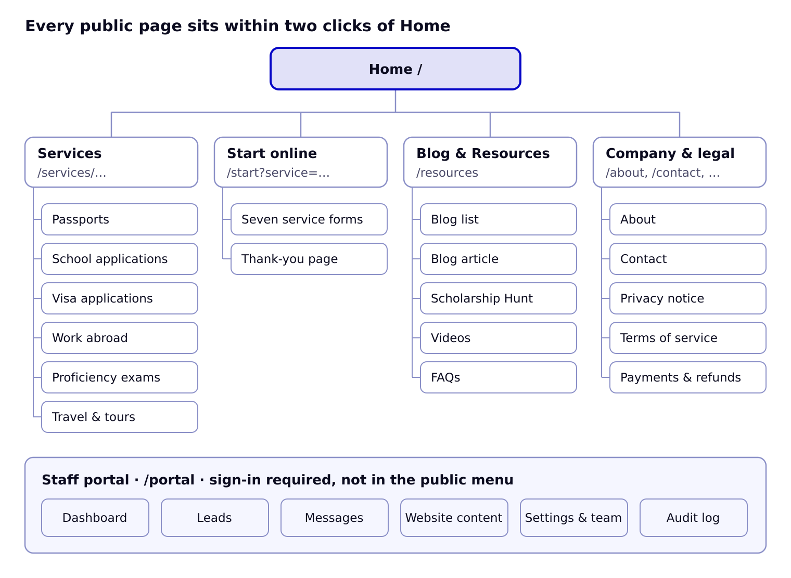

# Information Architecture

The public site has 21 page types under five top-level areas, plus the staff portal at /portal; every page is at most two clicks from the home page.

## Sitemap

Services, Start online, Blog & Resources and Company pages hang directly off Home; the staff portal is a separate area reached only by signing in.

## Pages and URLs

| Page | URL | Template | Content from | Primary action |
| --- | --- | --- | --- | --- |
| Home | / | Home | Settings, Team, Drives, Testimonials, latest Posts, Scholarships, Videos | Start online |
| Passports & Birth Certificates | /services/passports | Service | Settings (prices), Drives, FAQs | Start online (passport) |
| School Applications | /services/school-applications | Service | Programmes, Videos | Start online (school) |
| Visa Applications | /services/visa-applications | Service | FAQs, Videos | Start online (visa) |
| Work Abroad | /services/work-abroad | Service | Openings, Programmes | Start online (work) |
| Proficiency Exams | /services/exams | Service | Settings (prices), FAQs | Start online (exams) |
| Travel & Tours | /services/travel | Service | Trips | Request a quote |
| Start online | /start?service={key} | Form | Form definitions, Settings | Save and continue |
| Thank you | /start/done?ref={ref} | Form | Lead, Settings | Message us now |
| Blog & Resources | /resources | Hub | latest Posts, Scholarships, Videos | Section cards |
| Blog | /resources/blog?topic={topic}&page={n} | List | Posts | Read article |
| Article | /resources/blog/{slug} | Article | Post, Team member | Start online box |
| Scholarship Hunt | /resources/scholarships?status={status} | List | Scholarships | Official page / Get help |
| Videos | /resources/videos?platform={platform} | List | Videos | Play |
| FAQs | /resources/faqs?topic={service} | List | FAQs | WhatsApp us |
| About | /about | Content | Team, Settings | Start online |
| Contact | /contact | Content + form | Settings (offices, contacts) | Send message |
| Privacy notice | /privacy | Legal | Static text from ELC | — |
| Terms of service | /terms | Legal | Static text from ELC | — |
| Payments & refunds | /payments | Legal | Static text from ELC | — |
| Not found | (any) | Error | — | Home, Start online |
| Staff portal | /portal/… | Portal | Everything | Sign in |

Portal routes: /portal (dashboard), /portal/leads, /portal/leads/{id}, /portal/messages, /portal/subscribers, /portal/content/{type} and /portal/content/{type}/{id} for scholarships, posts, videos, programmes, openings, drives, trips, faqs, team, testimonials, /portal/settings/{section}, /portal/audit, /portal/sign-in.

## Navigation

- **Header:** Home · Services (6 links) · Blog & Resources (Blog, Scholarship Hunt, Videos, FAQs) · About · Contact · WhatsApp · Start online. Top bar: phones, hours, LIVE note.
- **Footer:** CTA bar; Services; Resources; Company (About, Team, Host a passport drive, Partner with us, Internships & NSS, Book the CEO, Contact, Start online); Visit or call; Scholarship Hunt alerts; legal links; no-guarantee line.
- **Phone bar** (under 820 px): Start online · WhatsApp · Call.
- **Breadcrumbs** on every page below the home page.
- **Portal sidebar:** Dashboard · Leads · Messages · Website content (Scholarship Hunt, Blog, Videos, Programmes & openings, Passport drives, Group trips, FAQs, Team, Testimonials) · Settings & team · Audit log.

## Redirects from the current site

| Old URL | New URL |
| --- | --- |
| /index.html | / |
| /about-us/ | /about |
| /services/, /services/service-details/ | /services/passports |
| /projects/, /projects/projects-details/, /project-masonry/, /clients/ | / |
| /blog/ and old post slugs | /resources/blog |
| /faqs/ | /resources/faqs |
| /contact/ | /contact |
| /team/team-details/ | /about#team |
| /category/* | /resources/blog |
