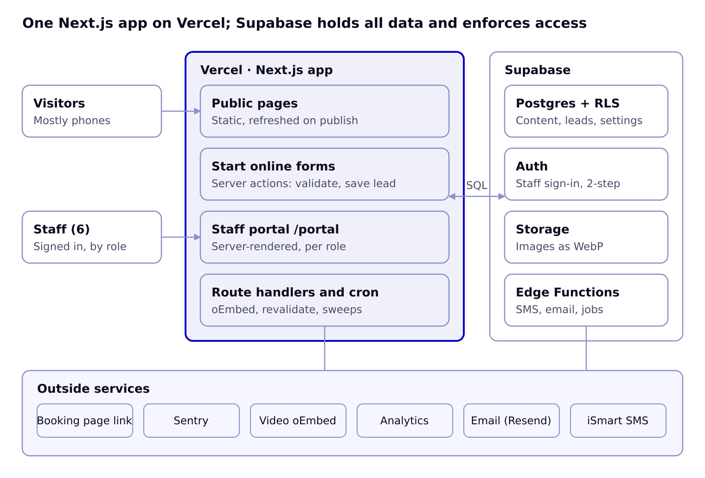
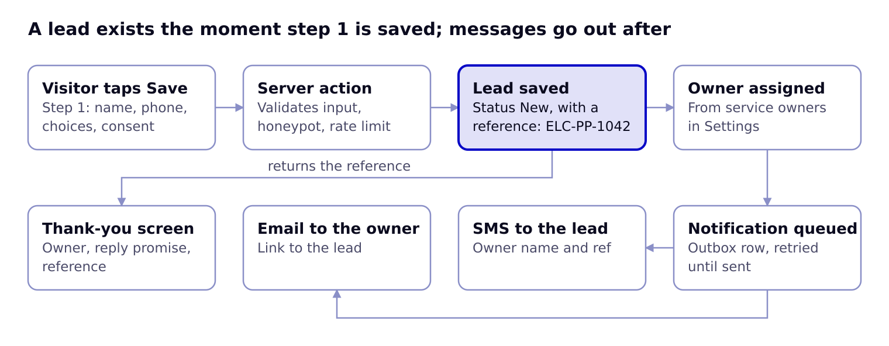

# System Architecture

One Next.js app on Vercel serves the public site, the Start online forms and the staff portal; Supabase holds every record and enforces who can read or change it.

## System overview



Visitors and staff reach the same Next.js app; it talks to Supabase over SQL with row-level security, and only server code and Edge Functions call the outside services. The booking page is a plain outbound link.

## Lead capture flow



The visitor sees the thank-you screen as soon as the lead is saved; SMS and email go out through an outbox table, so a provider outage delays messages but never loses a lead.

## Technology stack

| Layer | Choice | Why |
| --- | --- | --- |
| Framework | Next.js (App Router), TypeScript, React Server Components | Static pages for speed, server actions for forms, one codebase for site and portal |
| Styling | Tailwind CSS with ELC design tokens; shadcn/ui primitives (Radix) restyled to the Design System | Accessible primitives, tokens shared with the design system |
| Forms | React Hook Form + Zod (same schema on client and server) | One source of validation rules per form step |
| Database | Supabase Postgres with row-level security | Relational data, roles enforced in the database |
| Auth | Supabase Auth (email magic link or password; TOTP two-step for admins) | Invite-only staff accounts |
| Storage | Supabase Storage, public bucket for published images, private bucket for drafts | Images resized to WebP on upload |
| Jobs | Supabase pg_cron + Edge Functions; Vercel Cron for revalidation sweeps | Scholarship status, freshness flags, digests, notification retries |
| Rich text | Tiptap editor storing JSON; rendered to HTML on the server | Clean, safe blog content |
| Messaging | iSmart SMS; Resend email | Existing SMS provider; reliable transactional email |
| Monitoring | Sentry; Vercel Analytics or Plausible; first-party events table | Errors, page analytics, funnel events |
| Testing | Vitest (units), Playwright (end-to-end), axe-core (accessibility) | Every form tested end to end before release |

## Repository structure

```text
elc-web/
  app/
    (site)/                 public pages: page.tsx, services/[slug], resources/..., about, contact, start
    (portal)/portal/        dashboard, leads, messages, content/[type], settings/[section], audit
    api/                    oembed, revalidate, cron/*, webhooks/sms
    layout.tsx, sitemap.ts, robots.ts, not-found.tsx
  components/
    ui/                     design-system components (Button, Field, Card, Badge, Tabs, Dialog...)
    site/                   Header, Footer, PhoneBar, ServiceCard, ProgrammeCard, VideoEmbed...
    forms/                  StartOnlineForm, StepRenderer, field components
    portal/                 Sidebar, DataTable, LeadPanel, ContentEditor, PublishBar...
  lib/
    supabase/               server.ts, client.ts, admin.ts (service role, server only)
    forms/                  form definitions per service + Zod schemas
    content/                queries per content type, cache tags
    notify/                 sms.ts, email.ts
    auth/                   roles and permission helpers
  styles/tokens.css         CSS variables generated from the Design System tokens
  supabase/
    migrations/             SQL: tables, enums, RLS policies, functions, cron jobs
    functions/              Edge Functions: send-notifications, scholarship-status, weekly-digest
    seed.sql                services, settings, team, sample content from the mockups
  tests/                    unit, e2e (Playwright), a11y
```

## Environments and deployment

| Environment | URL | Database | Deploys from |
| --- | --- | --- | --- |
| Local | localhost:3000 | Supabase CLI (local Docker) | Developer machine |
| Preview | per-branch Vercel URL | Supabase staging project | Every pull request |
| Staging | staging.ernestlinksconsult.com | Supabase staging project | main branch |
| Production | ernestlinksconsult.com | Supabase production project | Release tag, after staging sign-off |

Database changes ship only as SQL migrations in `supabase/migrations`, applied by CI to staging, then production. Secrets live in Vercel and Supabase environment settings, never in the repo: `NEXT_PUBLIC_SUPABASE_URL`, `NEXT_PUBLIC_SUPABASE_ANON_KEY`, `SUPABASE_SERVICE_ROLE_KEY` (server only), `ISMART_API_KEY`, `RESEND_API_KEY`, `META_OEMBED_TOKEN`, `REVALIDATE_SECRET`, `SENTRY_DSN`.

## Caching and revalidation

- Public pages are static. Each query is tagged by content type (`tag: scholarships`, `tag: settings`).
- Publishing, unpublishing or changing a setting in the portal calls `revalidateTag` for the affected tags, so changes appear within seconds; a 10-minute fallback revalidation catches anything missed.
- Scholarship status is computed in SQL from opens and deadline, and a nightly job revalidates the scholarship pages after midnight Africa/Accra time.

## Security model

- Visitors use the anon key and can only read published rows (RLS) and insert through server actions; they never write tables directly.
- Form submissions run in server actions that validate with Zod, check the honeypot and rate limit, then write with the service role.
- Staff requests carry the user's session; RLS checks `staff.role` and per-type permissions for every read and write.
- The service-role key exists only in server code and Edge Functions.
- Every change by staff is written to `audit_log` by database triggers.
