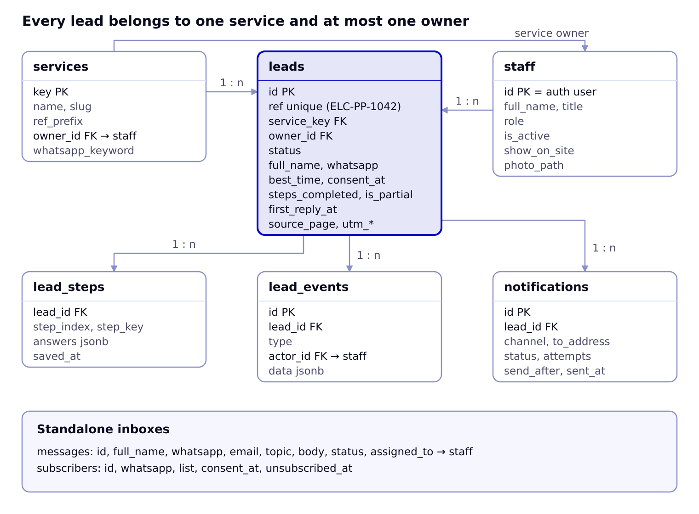
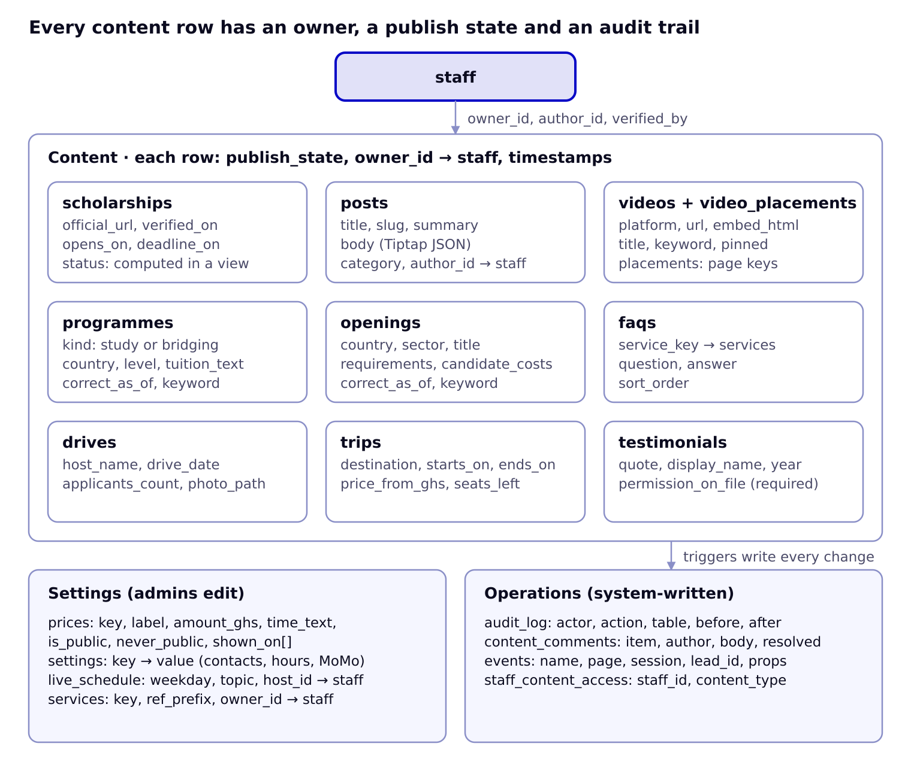

# Data Model (ERDs)

Twenty-five Postgres tables in three groups: leads and people, website content, and settings and operations. All use UUID keys and `created_at` / `updated_at` timestamps unless noted.

## ERD 1: leads and people



A lead points to its service and its owner; its saved steps, timeline events and outgoing messages each hang off it. Each service also names a default owner in staff.

## ERD 2: content, settings and operations



All nine content tables share the same publishing columns and point to staff; settings are admin-only key tables, and database triggers write every staff change to the audit log.

## Enums

| Enum | Values |
| --- | --- |
| staff_role | admin, editor, front_desk |
| lead_status | new, contacted, started, paid, closed |
| lead_event_type | created, step_saved, completed, status_changed, assigned, note, sms_sent, email_sent, merged |
| notify_channel | sms, email |
| notify_status | pending, sent, failed |
| publish_state | draft, in_review, published, archived |
| content_type | scholarship, post, video, programme, opening, drive, trip, faq, testimonial, team |
| video_platform | tiktok, instagram, facebook, youtube |
| post_category | passports, school_applications, visas, exams, scholarships, student_stories, work_abroad, travel |
| programme_kind | study, bridging |

## Tables

| Table | Key columns | Notes |
| --- | --- | --- |
| staff | id (= auth.users.id), full_name, title, role, phone, email, is_active, show_on_site, photo_path, bio, sort_order | One row per staff member; drives About page and portal access |
| staff_content_access | staff_id → staff, content_type | Which content types an editor may edit |
| services | key (passport, birth, school, visa, work, exams, travel), name, slug, ref_prefix (PP, BC, SA, VS, WA, EX, TR), owner_id → staff, whatsapp_keyword, sort_order | Seeded; owner gets new leads |
| leads | id, ref (unique, e.g. ELC-PP-1042), service_key → services, full_name, whatsapp, best_time, consent_at, status, owner_id → staff, steps_completed, steps_total, is_partial, form_version, source_page, referrer, utm_source, utm_medium, utm_campaign, heard_from, first_reply_at, closed_reason | Created at step 1; `ref` from a per-service sequence |
| lead_steps | lead_id → leads, step_index, step_key, answers (jsonb), saved_at | One row per saved step; answers validated by the step's Zod schema |
| lead_events | id, lead_id → leads, type, actor_id → staff (null for system), data (jsonb), created_at | Timeline in the lead panel |
| notifications | id, lead_id → leads (nullable), channel, to_address, template, payload, status, attempts, last_error, send_after, sent_at | Outbox processed by an Edge Function every minute |
| messages | id, full_name, whatsapp, email, topic, body, consent_at, status (new, handled), assigned_to → staff | General contact form |
| subscribers | id, whatsapp, list ('scholarship_alerts'), consent_at, unsubscribed_at | Footer alert sign-up |
| scholarships | id, slug, name, where_text, levels (text[]), covers, official_url, opens_on, deadline_on, deadline_text, verified_on, verified_by → staff, not_pay_to_apply, publish_state, owner_id | Public status comes from the `scholarships_public` view |
| posts | id, slug, title, summary, body (Tiptap JSON), body_html, category, author_id → staff, cover_path, cover_alt, seo_title, seo_description, publish_state, published_at, reviewed_by | Blog |
| videos | id, platform, url, embed_html, thumbnail_url, title, keyword, pinned, publish_state, added_by → staff, published_at | Embed fetched by /api/oembed |
| video_placements | video_id → videos, page_key (videos, home, school, visa, passports, work, …) | Where each video shows |
| programmes | id, kind, country, city, level, title, duration_text, tuition_text, keyword, correct_as_of, internal_school_name (never rendered), publish_state, owner_id | Programmes open now; bridging programmes also feed Work Abroad |
| openings | id, country, sector, title, requirements, candidate_costs, keyword, correct_as_of, publish_state, owner_id | Work abroad openings; review required |
| drives | id, host_name, drive_date, applicants_count, photo_path, publish_state | Track record cards |
| trips | id, title, destination, starts_on, ends_on, price_from_ghs, seats_left, photo_path, publish_state | Group trips |
| faqs | id, service_key → services (null = general), question, answer, sort_order, publish_state | FAQs page, service pages |
| testimonials | id, display_name, service_key, year, quote, photo_path, permission_on_file, publish_state | Cannot publish unless permission_on_file |
| content_comments | id, content_type, content_id, author_id → staff, body, resolved | Review comments on any content row |
| prices | key, label, amount_ghs, time_text, is_public, never_public, shown_on (text[]), updated_by | never_public rows (school application, visa processing) can never be rendered |
| settings | key, value (jsonb), updated_by | contacts, hours, reply_promise, official_momo, booking_url, offices |
| live_schedule | weekday (1–5), topic, host_id → staff, starts_at_time | Homepage LIVE strip |
| audit_log | id (bigserial), actor_id, action, table_name, row_id, before, after, created_at | Written by triggers on every staff change |
| events | id (bigserial), name, page, session_id, lead_id, props (jsonb), created_at | form_open, step_saved, whatsapp_click, … for the funnel |

## Access rules (row-level security)

| Table group | Anonymous visitor | Front desk | Editor | Admin |
| --- | --- | --- | --- | --- |
| Published content (all content tables) | Read rows where publish_state = published | Read | Read | Read |
| Draft and in-review content | None | None | Read and write for their content types; cannot set published on posts, openings, programmes | All |
| leads, lead_steps, lead_events | None (insert only through server actions with the service role) | Read all; update status, owner, notes | Read and update leads they own | All |
| messages, subscribers | None (server actions insert) | Read, update | None | All |
| prices, settings, live_schedule | Read public values via views | Read | Read | Read and write |
| staff, staff_content_access | Read show_on_site rows via a view | Read | Read | Read and write |
| audit_log, events | None | None | None | Read |

## Key SQL

```sql
-- Reference numbers: ELC-PP-1042
create sequence lead_ref_seq start 1000;
create function next_lead_ref(p_service text) returns text language sql as $$
  select 'ELC-' || s.ref_prefix || '-' || nextval('lead_ref_seq')
  from services s where s.key = p_service;
$$;

-- Public scholarship status computed from dates (Africa/Accra)
create view scholarships_public as
select s.*,
  case
    when s.deadline_on is not null and s.deadline_on < (now() at time zone 'Africa/Accra')::date then 'closed'
    when s.opens_on is not null and s.opens_on > (now() at time zone 'Africa/Accra')::date then 'opening_soon'
    else 'open'
  end as status
from scholarships s
where s.publish_state = 'published' and s.official_url is not null and s.not_pay_to_apply;

-- Example policy: editors manage only their content types
create policy editors_write_posts on posts for all to authenticated
using (is_admin() or has_content_access('post'))
with check (is_admin() or (has_content_access('post') and publish_state <> 'published'));
```

## Form definitions (in code)

Forms live in `lib/forms/{service}.ts` so they are versioned with the code; each lead stores `form_version`.

```ts
type Field =
  | { kind: 'text' | 'tel' | 'email' | 'date' | 'month' | 'number'; key: string; label: string; required?: boolean; hint?: string }
  | { kind: 'select' | 'radio' | 'checkboxes'; key: string; label: string; options: string[]; required?: boolean }
  | { kind: 'textarea'; key: string; label: string }
  | { kind: 'heading' | 'note'; label: string };
type Step = { key: string; title: string; intro?: string; fields: Field[]; schema: ZodSchema };
type ServiceForm = { service: ServiceKey; version: number; steps: Step[]; later: string[]; nextSteps: string[] };
```

Step contents follow the Start online mockup: passport (7 steps, from ELC's registration sheet without ID numbers, payment or facilitator fields), birth certificate (6, without the informant's ID number), school applications (5), visa (4), work abroad (3), exams (3), travel (3).
